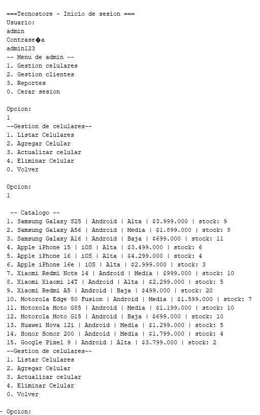
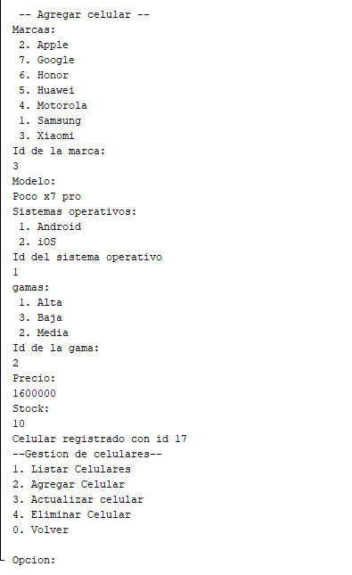
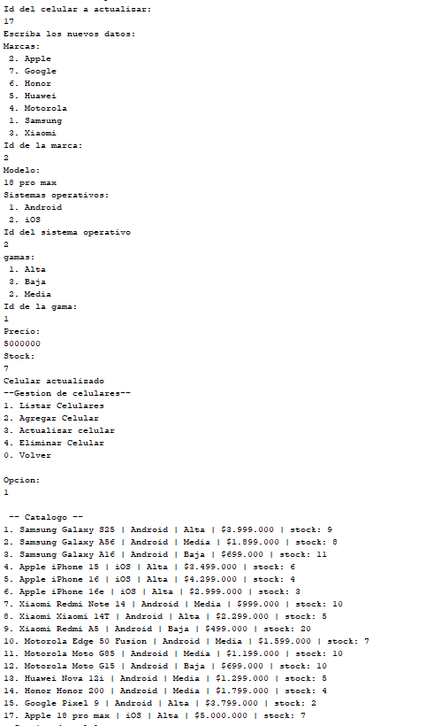
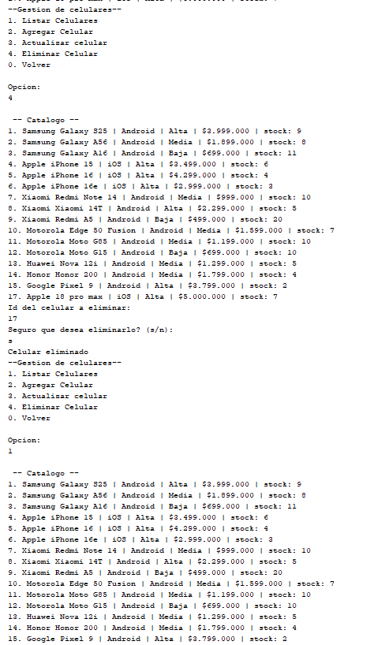
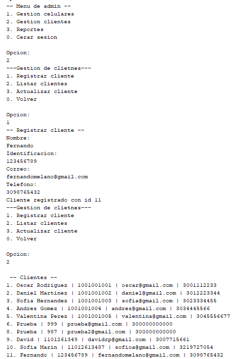
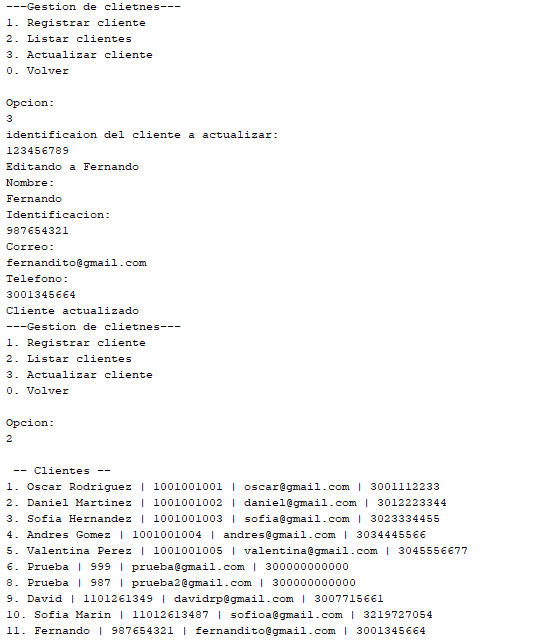
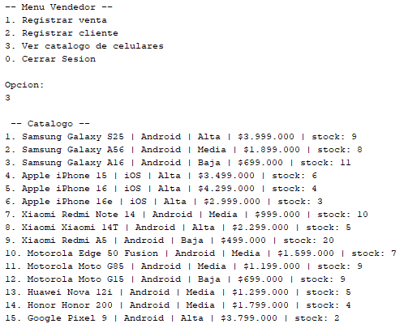
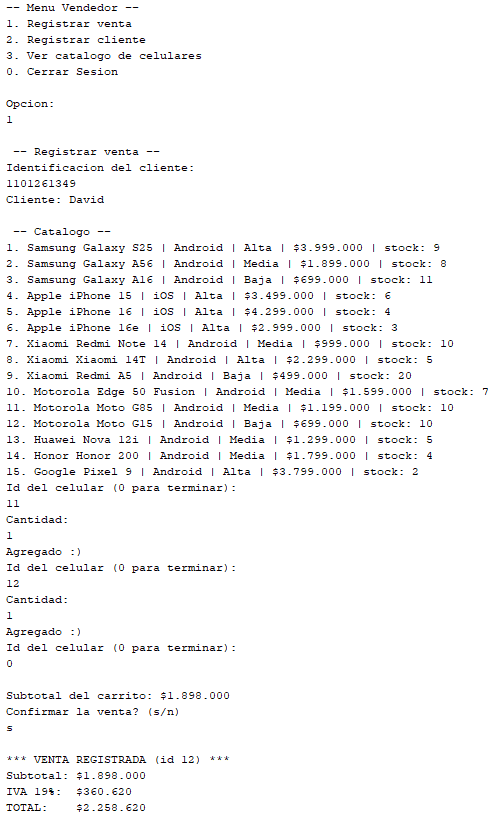
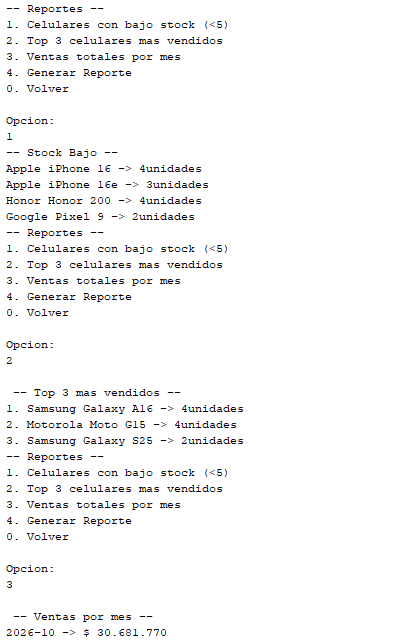
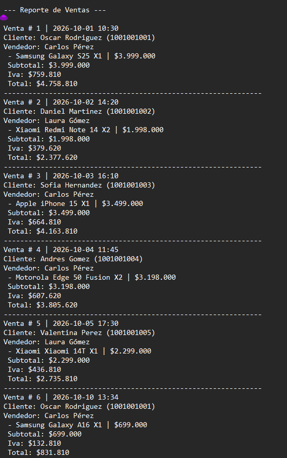

# Tecnostore

Sistema de consola en Java para gestionar el catálogo de celulares, los clientes, las ventas y los reportes de una tienda minorista de teléfonos celulares.

---

## 1. Descripción del proyecto

**TecnoStore** es una tienda de celulares de diferentes marcas y gamas que llevaba el control de ventas, inventario y clientes de forma manual en hojas de cálculo. Este proyecto automatiza ese control con una aplicación de consola que guarda toda la información en una base de datos **MySQL** mediante **JDBC**.

### Funcionalidades

| Módulo | Qué permite |
|---|---|
| **Inicio de sesión** | Ingreso con usuario y contraseña. Hay dos roles: **administrador** y **vendedor**, cada uno con su propio menú. |
| **Celulares** | Listar, agregar, actualizar y eliminar celulares. Cada celular tiene marca, modelo, sistema operativo, gama, precio y stock. Se valida que el precio sea mayor a 0 y que el stock no sea negativo. |
| **Clientes** | Registrar, listar y actualizar clientes (nombre, identificación, correo y teléfono). Se valida el formato del correo, el formato de la identificación y que la identificación sea única. |
| **Ventas** | Seleccionar un cliente por su identificación, agregar uno o varios celulares a un carrito, calcular el subtotal, el IVA del 19 % y el total, y guardar la venta. Al confirmar, el stock de cada celular se descuenta automáticamente. |
| **Reportes** | Celulares con stock bajo (menos de 5 unidades), Top 3 de celulares más vendidos y ventas totales por mes. Los cálculos se hacen con **Stream API** y colecciones. |
| **Archivo de reporte** | Genera el archivo `reporte_ventas.dat` con el resumen de todas las ventas. Se crea automáticamente al confirmar una venta y también desde el menú de reportes. |

### Tecnologías

- Java 21
- Maven
- MySQL y `mysql-connector-j` 8.4.0 (JDBC)
- Stream API, colecciones, `try-with-resources`

### Conceptos aplicados

- **Programación orientada a objetos:** encapsulamiento (atributos privados con getters y setters), composición (`Celular` tiene una `Marca`, una `Gama` y un `SistemaOperativo`; `Venta` tiene una lista de `DetalleVenta`).
- **Arquitectura por capas:** Model, View, Controller, Service y DAO, para que cada clase tenga una sola responsabilidad.
- **Excepciones:** excepción propia `NegocioException` para las reglas de negocio, y `try-with-resources` en el acceso a la base de datos y al archivo.
- **Patrón de diseño Strategy:** el cálculo del impuesto se define con la interfaz `CalculoImpuesto` y se implementa en `Iva`. `VentaService` recibe la estrategia por constructor, así se puede cambiar el impuesto sin modificar la lógica de la venta.

---

## 2. Estructura de clases

```
Tecnostore/
├── pom.xml
├── reporte_ventas.dat              ← se genera automáticamente
└── src/main/java/
    ├── Main/
    │   └── Tecnostore.java         ← clase principal (método main)
    ├── Model/                      ← entidades del negocio
    │   ├── Celular.java
    │   ├── Cliente.java
    │   ├── Venta.java
    │   ├── DetalleVenta.java       ← cada línea de una venta (celular y cantidad)
    │   ├── Marca.java
    │   ├── Gama.java               ← Alta, Media, Baja
    │   ├── SistemaOperativo.java
    │   ├── Usuario.java
    │   └── Rol.java
    ├── View/                       ← menús e interacción por consola
    │   ├── LoginView.java
    │   ├── MenuAdminView.java
    │   ├── MenuVendedorView.java
    │   ├── CelularView.java
    │   ├── ClienteView.java
    │   ├── ReporteView.java
    │   └── Validaciones.java
    ├── Controller/                 ← conecta las vistas con los servicios
    │   ├── LoginController.java
    │   ├── CelularController.java
    │   ├── ClienteController.java
    │   ├── VentaController.java
    │   └── ReporteController.java
    ├── service/                    ← reglas de negocio
    │   ├── LoginService.java
    │   ├── CelularService.java
    │   ├── ClienteService.java
    │   └── VentaService.java
    ├── dao/                        ← acceso a datos con JDBC
    │   ├── Conexion.java
    │   ├── CelularDAO.java
    │   ├── ClienteDAO.java
    │   ├── VentaDAO.java
    │   ├── UsuarioDAO.java
    │   ├── MarcaDAO.java
    │   ├── GamaDAO.java
    │   └── SistemaOperativoDAO.java
    ├── Impuesto/                   ← patrón Strategy
    │   ├── CalculoImpuesto.java    ← interfaz (estrategia)
    │   └── Iva.java                ← implementación: IVA del 19 %
    ├── exception/
    │   └── NegocioException.java
    └── util/
        ├── Validaciones.java       ← correo, identificación y teléfono
        ├── ReporteUtils.java       ← stock bajo, top 3 y ventas por mes (Stream API)
        └── ArchivoUtils.java       ← genera reporte_ventas.dat
```

### Correspondencia con la estructura sugerida en el enunciado

| Sugerida | En este proyecto |
|---|---|
| `ItemVenta` | `DetalleVenta` |
| `CategoriaGama` (enum) | `Gama` (se guarda en la tabla `gamas`) |
| `GestorCelulares`, `GestorClientes`, `GestorVentas` | `CelularService`, `ClienteService`, `VentaService` |
| `ConexiónDB` | `Conexion` |
| `Validador` | `util/Validaciones` |
| `StrategyDescuento` | `CalculoImpuesto` / `Iva` (Strategy aplicado al impuesto) |
| `Main.java` | `Main/Tecnostore.java` |

### Flujo de una venta

```
MenuVendedorView → VentaController → VentaService → VentaDAO → MySQL
                                          │
                                          └── CalculoImpuesto (Iva) → calcula el 19 %
```

Al confirmar, `VentaDAO` guarda la venta y sus detalles y descuenta el stock en una sola transacción. Después se regenera `reporte_ventas.dat`.

### Base de datos

| Tabla | Contenido |
|---|---|
| `marcas` | Samsung, Apple, Xiaomi, Motorola, Huawei, Honor, Google |
| `sistemas_operativos` | Android, iOS |
| `gamas` | Alta, Media, Baja |
| `celulares` | marca, modelo, sistema operativo, gama, precio y stock |
| `clientes` | nombre, identificación (única), correo y teléfono |
| `roles` | administrador y vendedor |
| `usuarios` | nombre, usuario, contraseña y rol |
| `ventas` | cliente, vendedor, fecha, subtotal, IVA y total |
| `detalle_ventas` | venta, celular, cantidad, precio unitario y subtotal |

---

## 3. Ejemplo de ejecución

Credenciales de prueba para el administrador: usuario `admin`, contraseña `admin123`.

### Menú de administrador y listado de celulares

El administrador entra a **Gestión celulares** y lista el catálogo.



### Agregar un celular

Se elige la marca, el modelo, el sistema operativo, la gama, el precio y el stock. El sistema devuelve el id del nuevo celular.



### Actualizar un celular

Se ingresa el id del celular y los nuevos datos. Después se lista el catálogo para ver el cambio.



### Eliminar un celular

Se ingresa el id y el sistema pide confirmación antes de eliminarlo.



### Registrar un cliente



### Actualizar un cliente

El cliente se busca por su identificación.



### Catálogo desde el menú del vendedor



### Registrar una venta

El vendedor ingresa la identificación del cliente, agrega celulares al carrito (con `0` termina), confirma, y el sistema calcula el subtotal, el IVA del 19 % y el total.



### Reportes

Menú de reportes con celulares con stock bajo, Top 3 más vendidos y ventas totales por mes.



### Archivo `reporte_ventas.dat`

Resumen de todas las ventas, con cliente, vendedor, detalle, subtotal, IVA y total.



---

## 4. Indicaciones para la conexión a MySQL

### Requisitos

- JDK 21 o superior
- MySQL 8 en ejecución
- Maven (o NetBeans, que ya lo incluye)

### Paso 1: crear la base de datos

Abre una terminal de MySQL o MySQL Workbench y ejecuta:

```sql
CREATE DATABASE tecnostoreoscar_db CHARACTER SET utf8mb4;
USE tecnostoreoscar_db;
```

Después ejecuta el script `tecnostore_db.sql`, que crea las tablas y carga los datos de prueba:

```
mysql -u root -p tecnostoreoscar_db < tecnostore_db.sql
```

### Paso 2: configurar la conexión

La conexión está en `src/main/java/dao/Conexion.java`:

```java
DriverManager.getConnection(
    "jdbc:mysql://localhost:3306/tecnostoreoscar_db", "root", "TU_CONTRASEÑA");
```

Cambia estos tres valores según tu instalación:

| Valor | Por defecto |
|---|---|
| Servidor y puerto | `localhost:3306` |
| Nombre de la base de datos | `tecnostoreoscar_db` |
| Usuario y contraseña | `root` y la que definiste al instalar MySQL |

> **Importante:** no subas tu contraseña real a GitHub. Antes de publicar el repositorio, reemplázala por un valor de ejemplo.

### Paso 3: ejecutar el proyecto

**Desde NetBeans:** abre el proyecto y presiona **Run**. Maven descarga el driver de MySQL automáticamente.

**Desde la terminal**, en la carpeta donde está el `pom.xml`:

```
mvn compile exec:java "-Dexec.mainClass=Main.Tecnostore"
```

### Problemas frecuentes

| Mensaje | Causa y solución |
|---|---|
| `Communications link failure` | MySQL está apagado o el puerto no es el 3306. Inicia el servicio de MySQL. |
| `Access denied for user 'root'` | El usuario o la contraseña de `Conexion.java` no coinciden con los de MySQL. |
| `Unknown database` | No se creó la base de datos. Repite el paso 1. |
| `Table ... doesn't exist` | No se ejecutó el script `tecnostore_db.sql`. |
